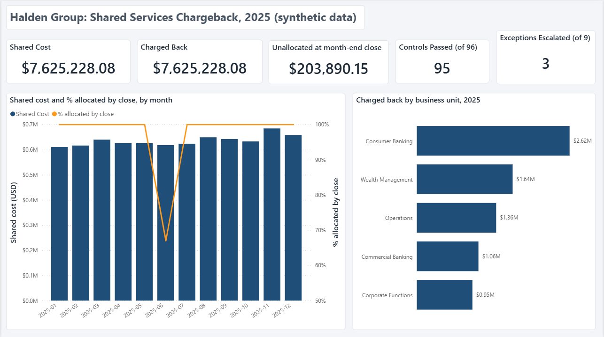
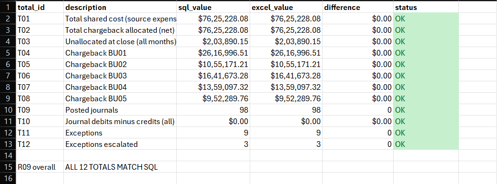
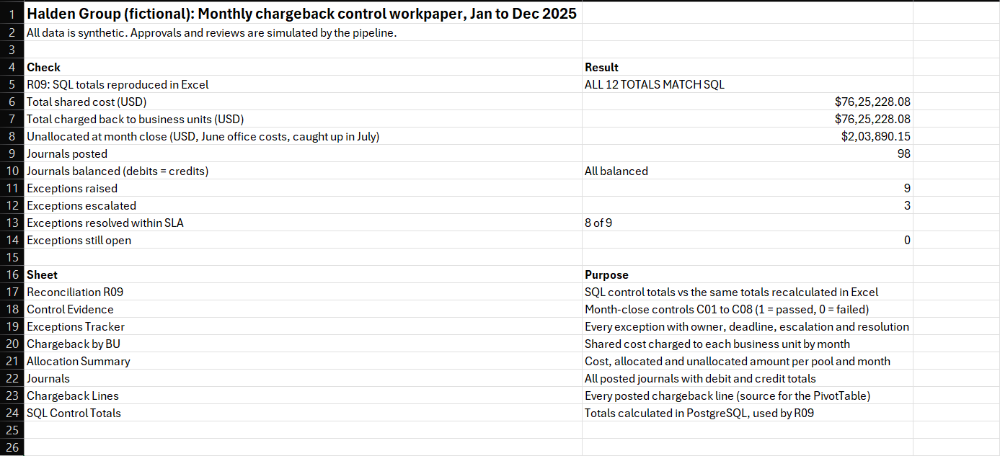
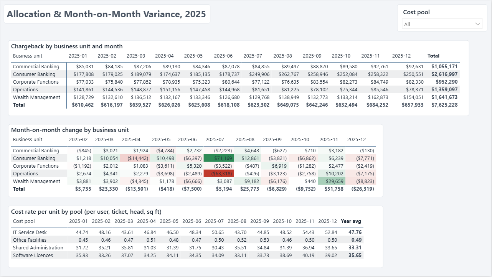
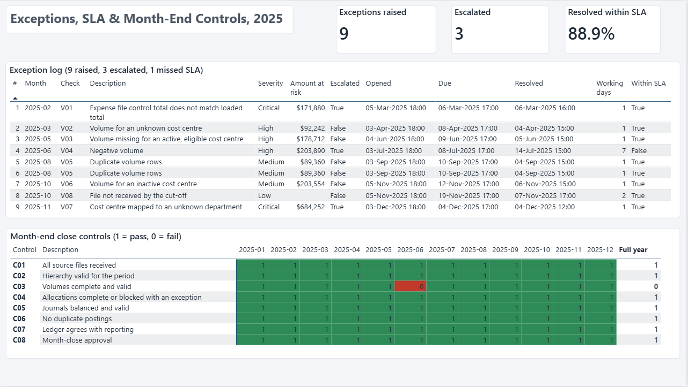
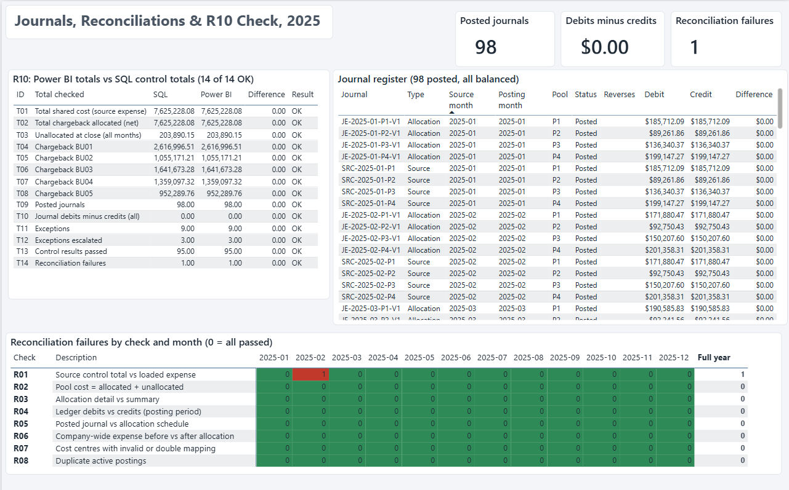

# Enterprise Cost Allocation, Chargeback Controls & BI Reporting

A monthly shared-cost chargeback process for a fictional company (Halden Group), built in PostgreSQL and Python and reported in Excel and Power BI. It covers one year (January to December 2025): source files arrive each month, are validated, allocated to business units, posted as balanced journals, reconciled, and closed with a control checklist. Problems are planted in the data on purpose to show how the process catches and handles them.

**All data is synthetic.** The company, cost centres, amounts and approvals are invented. Reviewer approvals are simulated by the pipeline and labelled as simulated. Nothing is posted to a real ledger.



## What the process does

Four shared services (software licences, IT service desk, shared administration, office facilities) are paid centrally and charged back to 61 cost centres in 5 business units, using a driver for each pool (licensed users, support tickets, headcount, floor area).

For each month the pipeline replays the timeline a finance team would follow:

1. **Cut-off run** on working day 3 at 18:00, using the files received so far.
2. **Validation checks** (V01 to V09). A failed check opens an exception with an owner, a due date and an amount at risk, and blocks that pool. Missing data is never treated as zero.
3. **Allocation** with exact decimals. Rounding uses the largest-remainder method, so each pool's allocations add back to its cost to the cent.
4. **Journals** go from draft to validated to approved (simulated reviewer) to posted. Re-running a month posts nothing new. Corrections after posting create a reversal and a replacement journal instead of changing history.
5. **Reruns** one hour after a corrected file arrives, before close.
6. **Reconciliations** R01 to R08 after every run.
7. **Month close** on working day 6 at 17:00 with controls C01 to C08. The close is rejected if a Critical exception is still open.
8. **Daily escalation check** at 09:00 on working days for exceptions past their due date.
9. **Adjustments** for files that arrive after a month has closed, posted in the next open month.

Hierarchy changes (a cost centre moving business unit, a department moving, a cost centre closing) are effective-dated, so each month is reported under the structure that applied at the time. The full business rules are in [docs/design.md](docs/design.md).

## Results for 2025

| Item | Result |
|---|---|
| Shared cost posted | $7,625,228.08 |
| Charged back to business units | $7,625,228.08 (100%) |
| Unallocated at a month-end close | $203,890.15 (June office facilities, caught up in July) |
| Process runs | 33 (12 cut-off, 7 reruns, 2 adjustments, 12 closes) |
| Journals posted | 98, all balanced |
| Exceptions | 9 raised, 3 escalated, 8 of 9 resolved within SLA |
| Reconciliation checks | 491 run, 490 passed (the failure is the planted February cut-off) |
| Month-close controls | 96 results, 95 passed (June C03), all 12 closes approved |

## How the planted problems were handled

| Month | Problem in the data | What happened |
|---|---|---|
| Feb | Software expense file total does not match its control total | V01 Critical, escalated at once ($171,880 at risk), pool blocked, corrected file the next day, rerun |
| Mar | IT ticket volume for an unknown cost centre | V02 High, blocked, corrected file, rerun |
| Apr | CC1023 moves from Commercial Banking to Operations | Charged to Operations from April only |
| May | Licence volume missing for an active cost centre | V03 High, blocked, rerun |
| Jun | Negative floor area | V04 High. The corrected file arrived after the June close, so June office cost ($203,890.15) stayed unallocated at close and was posted as a catch-up in July. Escalated on 9 Jul at 09:00 when past due. The only SLA miss. |
| Jun | April headcount for CC1015 was wrong | Reversal of the April journal and a replacement journal, both posted in June. CC1015's April share went from $3,335.35 to $2,730.43. |
| Jul | Customer Service moves from Operations to Consumer Banking | Consumer Banking +$71,169 and Operations −$63,318 month on month |
| Jul | IT service desk driver changes from tickets raised to tickets resolved | New policy version from 1 July |
| Aug | Duplicate volume rows | V05 Medium, blocked until removed |
| Sep | CC1047 closes | No allocations from September |
| Oct | Late file; volume sent for the closed CC1047 | V08 Low warning; V06 Medium, blocked |
| Nov | Cost centre mapped to an unknown department | V07 Critical, escalated at once, all pools blocked, corrected mapping file the next day and rerun before close |
| Any | Rerun of a finished month | 0 new journals |

The expected outcomes are kept in `data/answer_key/expected_exceptions.csv` and are used only by the tests.

## Reporting

**Excel control workpaper** (`excel/chargeback_control_workpaper.xlsx`), built with Power Query from the exported reporting tables:
- R09: 12 SQL control totals recalculated in Excel with SUMIFS, COUNTIFS and XLOOKUP, all matching
- control evidence and exceptions tracker with conditional formatting
- chargeback by business unit (PivotTable)

| | |
|---|---|
|  |  |

**Power BI report** (`powerbi/chargeback_report.pbix`), connected to the PostgreSQL reporting views with a star schema and DAX measures. Four pages:
- **Overview:** cost, chargeback, allocated-by-close %, controls and escalations
- **Allocation & Variance:** chargeback by business unit and month, month-on-month change, cost rates per pool
- **Exceptions & Controls:** exception log with SLA results, close controls by month
- **Journals & Reconciliation:** journal register, reconciliation results, and R10 (14 Power BI totals checked against SQL control totals, all matching)

| | |
|---|---|
|  |  |
|  | |

## Tests

`tests/` has 30 tests (pytest). They check the finished year against the answer key and the rules: exceptions, escalation times, SLA, totals by business unit, hierarchy moves, the closed cost centre, the policy change, balanced journals, the April correction, rerun idempotency, the single reconciliation and control failure, and that an open Critical exception rejects the month close while an open High one does not. Twelve of the tests recalculate allocations from the raw CSV files with pandas, without any SQL, and compare them to what was posted. Each test runs in a transaction that is rolled back, so the data is not changed.

## Tools

PostgreSQL 17 (schemas, PL/pgSQL functions, views), Python 3.13 (psycopg2, pandas, pytest), Excel (Power Query, PivotTables, SUMIFS, XLOOKUP, conditional formatting), Power BI Desktop (data model, DAX, conditional formatting).

## Project structure

```
data/raw/            monthly source files (expenses, volumes, hierarchy changes) and reference data
data/answer_key/     expected exceptions, used only by the tests
sql/                 01 schema, 02 functions (validation, allocation, reconciliation), 03 reporting views
src/                 generate_data.py, load_sources.py, pipeline.py, export_reporting.py, db.py
tests/               acceptance tests and the independent pandas recalculation
reporting/           reporting views exported to CSV, plus SQL control totals
excel/               control workpaper
powerbi/             Power BI report and theme
docs/                design, month-end SOP, data dictionary, management summary
screenshots/
```

## How to run

Requires PostgreSQL and Python 3. The scripts ask for the PostgreSQL password and do not store it. Use `--port` if PostgreSQL is not on 5432.

```
pip install -r requirements.txt
python src/generate_data.py                      # optional: rebuild the source files (fixed seed, same output)
python src/load_sources.py --port 5433           # create the database, tables, functions and views, load the files
python src/pipeline.py run-year --port 5433      # run the year: 33 runs and 12 closes
python src/pipeline.py show --period 2025-06 --port 5433
python src/pipeline.py rerun --period 2025-03 --port 5433   # rerun a finished month: 0 new journals
python src/export_reporting.py --port 5433       # export reporting tables for Excel and Power BI
python -m pytest -s -v tests --port 5433
```

To refresh the Power BI report, point its PostgreSQL source at your server (Transform data > Data source settings).

## Limits

- One year of synthetic data for one company; no real ERP, general ledger or approval workflow.
- Reviewer approvals are simulated by the pipeline.
- The timeline is replayed by the script, not run by a scheduler.
- Power BI uses Import mode from a local PostgreSQL database, so the report needs that database to refresh.
